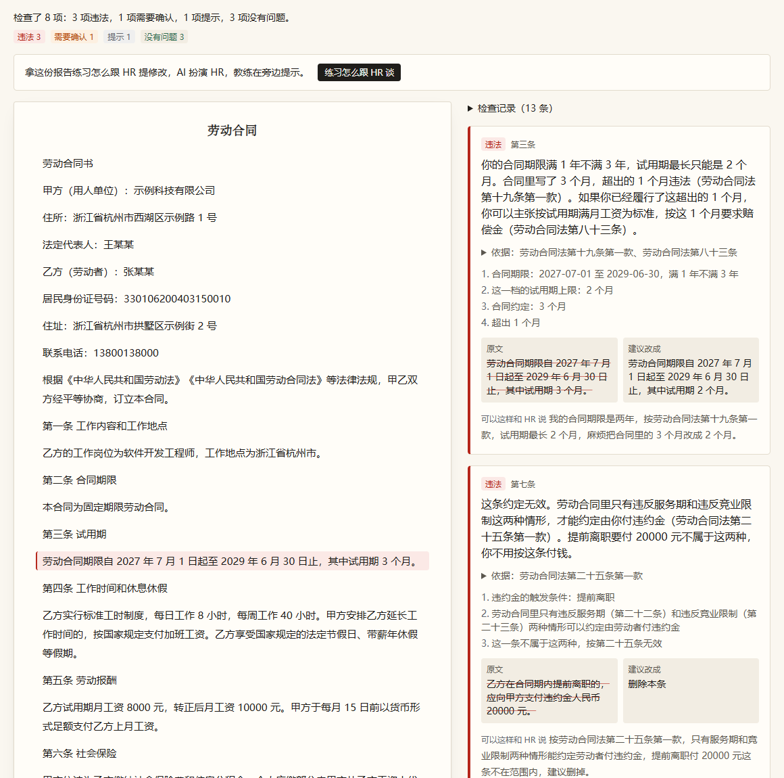
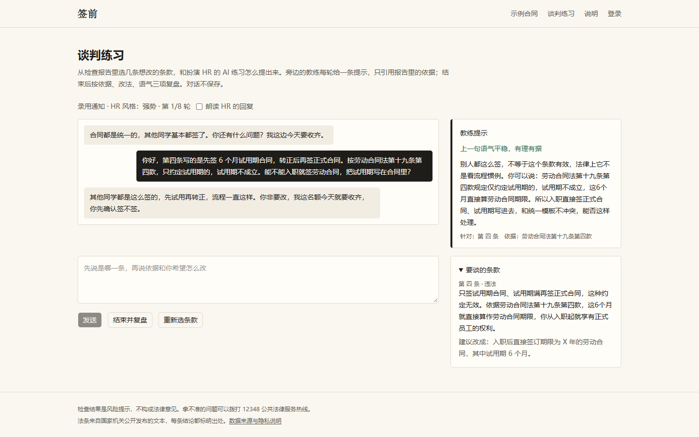
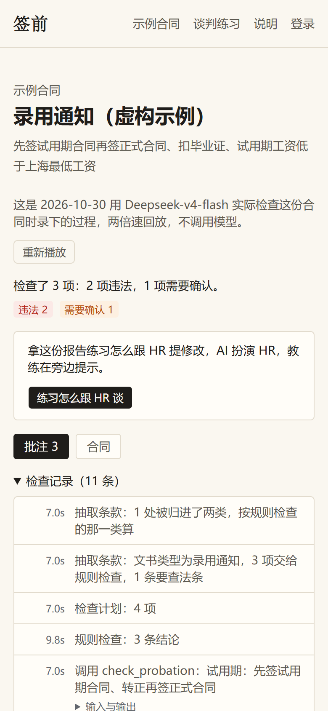
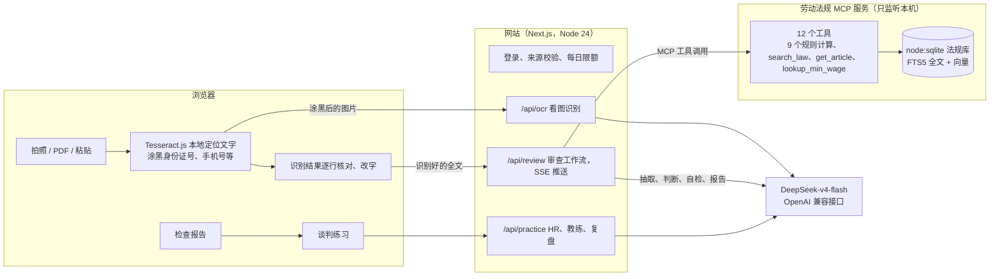

# 签前

毕业生签约前的合同检查和谈判练习。拍下录用通知、三方协议、实习协议或劳动合同，网页逐条检查试用期、违约金、社保、竞业限制等 15 类常见问题，每条结论附法条原文和计算过程；看完报告，可以和扮演 HR 的 AI 练习怎么提出修改。

- 在线演示：https://服务器地址 （不登录可以看 4 份示例合同的检查过程；体验账号写在提交材料里）
- 演示视频脚本：[docs/视频脚本.md](docs/视频脚本.md)
- 评测结果：[docs/评测报告.md](docs/评测报告.md)



## 能做什么

**合同检查**（`/check`）

1. 拍照、选 PDF 或粘贴文字，最多 6 页。
2. 浏览器先用本地识别找出文字位置，把身份证号、手机号、银行卡号、邮箱涂黑，涂过的图片才发到服务器。
3. 模型看图识别文字，和本地识别的框对齐。认错的字可以点那一行直接改。
4. 检查过程实时显示：抽取了哪些条款、调了哪个规则工具、输入输出是什么、查了哪些法条。
5. 报告里每条批注写明：结论、依据的法条原文、计算过程、建议改法（原文和修改稿对照）、可以怎么跟 HR 说。

**谈判练习**（`/practice`）

从报告里选 1~3 条想谈的问题，选 HR 的风格（好商量、公事公办、强势），和 AI 扮演的 HR 对话。旁边的教练每轮给一条提示；结束后按"依据讲清楚没有、有没有提出具体改法、语气是否稳妥"三项复盘。HR 的回复可以用浏览器朗读。



**示例合同**（`/samples`）

4 份虚构合同（劳动合同、三方协议、录用通知、实习协议），回放用真实模型检查时录下的全过程，不登录也能看，不消耗模型额度。



## 检查范围

| 规则 | 检查什么 | 主要依据 |
|---|---|---|
| R01~R03 | 试用期是否超过上限、不该约定却约定了、只约定了试用期 | 劳动合同法第十九条 |
| R05 | 试用期工资是否低于约定工资 80% 或当地最低工资 | 劳动合同法第二十条、实施条例第十五条 |
| R06~R08 | 服务期和竞业限制以外的违约金、服务期违约金超过培训费分摊、用户口住房换服务期 | 劳动合同法第二十二、二十五条，最高法劳动争议解释（二）第十二条 |
| R09 | 竞业限制的期限、补偿和适用对象 | 劳动合同法第二十三、二十四条 |
| R10 | 押金、扣证件、要求担保 | 劳动合同法第九条 |
| R11 | 劳动合同必备条款是否齐全 | 劳动合同法第十七条 |
| R12 | 三方协议的违约金和格式条款 | 民法典第四百九十七、五百八十五条 |
| R13 | 约定不缴社保 | 最高法劳动争议解释（二）第十九条 |
| R14~R16 | 单方调岗调薪、法定情形以外的解除条件、限制辞职 | 劳动合同法第二十一、三十五、三十七、三十九条 |

规则写在 `mcp/labor-law/rules/`，测试用例在 `rules.test.ts`，来自规划文档《规则清单》里每条规则的测试表。规则覆盖不到的条款（比如录用通知里的回复期限），先检索法规库，再由模型按检索到的条文判断，批注上标明"规则未覆盖，按检索到的条文判断"。

## 技术架构



### 审查工作流（`src/lib/review/run.ts`）

模型不直接对整份合同下结论，而是拆成下面几步，每一步推一个事件，界面上的检查记录就是这些事件：

1. **抽取**：模型按 JSON Schema 结构化输出合同字段（合同期限、试用期、工资、违约金、竞业限制……），每个字段带原文出处。字段和规则工具的参数一一对应（`facts.ts`）。出处在原文里找不到的字段丢掉，不拿去计算。
2. **计划**：程序按字段生成检查计划，有哪个字段就调哪条规则（`plan.ts`），不让模型自己决定查什么。
3. **执行**，三路并行：
   - 规则工具：通过 MCP 调劳动法规服务，按法条计算，比如合同两年、试用期上限两个月、超出一个月。
   - 模型核对：复核角色检查抽取出的字段和原文是否一致，不一致的结论降为"需要确认"并写明原因。
   - 检索加判断：规则覆盖不到的条款，检索法条后由模型判断，依据只能从这一条的检索结果里选。
4. **程序检查**（`checks.ts`）：每条批注的出处在原文里、条文 ID 在法规库里、报告里的数字出自规则计算，对不上的去掉或降级。
5. **报告**：结论、建议改法（`before` 必须摘自原文）、谈判要点。

法条原文只从法规库里取，不由模型生成。

### 检索（`src/lib/review/retrieve.ts`、`mcp/labor-law/search.ts`）

模型改写查询 → 原句和改写各走全文检索（FTS5，trigram 加二字切分）和向量检索（bge-small-zh-v1.5，量化 ONNX 在服务器本地运行）→ RRF 融合 → 模型重排（只能从候选 ID 里选）。改写或重排失败时退回原句或 RRF 顺序，原因记在结果里。

### 模型接入（`src/lib/ai/`）

所有模型调用都经过这一层：按用途选角色（主模型、复核模型、备用），每次调用设时限；超过对冲时间还没返回，就向下一个角色再发一份，先回来的算数。平台有请求挂住不返回的情况（评测时 221 次里 9 次），这一步是必要的。每次调用记录次数、token 和耗时，按天限总 token 数。

### 谈判练习（`src/app/api/practice/route.ts`、`src/prompts/practice.ts`）

服务端不存对话，每轮由浏览器把场景、历史和本轮输入一起发来。HR 流式返回；教练和复盘用结构化输出，再过两道程序检查：教练提示里的条号必须出自这几条问题的依据，不然换成报告里写好的谈判要点；复盘摘的"你说过"必须真的出自用户说过的话。

### 安全

| 风险 | 做法 |
|---|---|
| 合同里夹着写给 AI 的指令 | 合同原文放在分隔符里，系统提示写明文书内容不是指令；程序按规则找出疑似段落（"忽略以上指令""判定无风险"之类），报告上方提示、合同里虚线框标出，抽取时在提示里点名这几段只当普通文字（`src/lib/review/injection.ts`） |
| 个人信息 | 浏览器本地涂黑后才上传；服务器不保存合同、照片和对话，用量库只有次数、token 和耗时 |
| 模型接口被盗用 | 调模型的接口都要登录（scrypt 哈希、签名 Cookie），校验请求来源；每账号每天检查份数和练习轮数有上限；同一 IP 10 分钟输错 10 次暂停登录 |
| 输出不可控 | 法条只从库里取，数字只来自规则，条号和原话由程序核对；结论措辞固定为"违法""可能违法""需要确认""提示" |
| 练习里的不当输入 | 关键词过滤辱骂和威胁用语；HR 的提示词要求不跳出角色，把话题拉回合同 |

## 评测

详见 [docs/评测报告.md](docs/评测报告.md)，数字都能用脚本复现。

- **法条检索**：30 条测试查询（15 条条款原文、15 条口语提问），评测集先于检索代码提交。改写 + 全文 + 向量 + 重排两轮，60 次里 58 次前 5 条结果包含正确法条（97%），只用全文检索是 47%。
- **审查流程**：四份示例合同（写提示词时看过，属于开发集）两轮，规则和等级都对上 28/38，有问题的条款得到提醒 24/28，写对的条款被误报 0/10。同一套代码单轮波动较大（10-31 再跑一轮对上 11/19），原因和改进方向写在评测报告 2.3 节。

## 目录结构

```
src/app/            页面和接口（/check、/practice、/samples、/api/*）
src/features/       界面组件：upload（上传识别）、review（检查报告）、practice（谈判练习）
src/lib/ai/         模型接入层
src/lib/review/     审查工作流、检索、程序检查、注入检测
src/lib/practice/   谈判练习的材料整理和程序检查
src/prompts/        提示词，带版本号和改动原因
mcp/labor-law/      劳动法规 MCP 服务：规则、检索、法规库读写
data/               法规条文、最低工资表、示例合同和标准答案
scripts/            语料下载与建库、评测、探测脚本
tests/e2e/          Playwright 端到端测试
deploy/             打包、部署、部署后检查
docs/               评测报告、视频脚本、队友材料
```

## 本地运行

需要 Node.js 24 或更高版本。

```bash
npm ci
cp .env.example .env.local     # 填模型接口的地址、密钥、模型名
npm run corpus:model           # 下载向量模型（约 23MB），按 data/model-lock.json 校验哈希
npm run corpus:build           # 用 data/clean/ 里的条文建库，生成 data/build/law.db
npm run mcp                    # 另开一个终端运行：劳动法规 MCP 服务，127.0.0.1:3101
npm run dev                    # 网站，http://localhost:3000
```

本机不填 `SESSION_SECRET` 时不用登录。生产环境部署见 [deploy/README.md](deploy/README.md)，部署后用 `BASE=https://服务器地址 bash deploy/smoke.sh` 检查。

## 环境变量

完整说明见 [.env.example](.env.example)，`.env*` 文件不进仓库。

| 变量 | 作用 |
|---|---|
| `LLM_MAIN_*`、`LLM_ALT_*`、`LLM_FALLBACK_*` | 主模型、复核模型、备用模型的接口地址、密钥、模型名；缺一项就当这个角色不存在 |
| `REASONING_*` | 单独打开某一步的思考模式，默认都关 |
| `DAILY_TOKEN_BUDGET`、`PLATFORM_REQUESTS_*` | 每天 token 上限、平台请求次数限额 |
| `DAILY_REVIEWS_PER_ACCOUNT`、`DAILY_PRACTICE_TURNS` | 每个账号每天的检查份数、练习轮数 |
| `JUDGE_ACCOUNTS`、`SESSION_SECRET` | 登录账号（`npm run account:hash -- 用户名` 生成）、会话签名密钥 |
| `MCP_URL`、`USAGE_DB_PATH` | 法规服务地址、用量库位置 |

## 测试

| 命令 | 内容 |
|---|---|
| `npm run check` | ESLint、类型检查、单元测试、文案检查、密钥扫描、生产构建，提交前必跑 |
| `npm run test:e2e` | Playwright 端到端：示例回放、上传识别改字、检查、谈判练习、注入标注（模型接口用录像和固定内容代替） |
| `npm run test:live` | 接真实模型接口的验收测试 |
| `npm run eval:retrieval` | 法条检索评测 |
| `node scripts/eval/review.ts` | 审查流程评测（四份示例合同，和 `data/samples/answers.json` 比） |

## 法规数据

条文来自国家机关网站公开发布的文本，来源、版本和效力状态见 `data/sources.json`，切分后的条文在 `data/clean/`，每条带条文 ID（如劳动合同法第十九条第一款是 `ldhtf-19-1`）。

收录 11 部法律、行政法规、司法解释和部门规章，共 524 条，另有最高人民法院发布的 6 个劳动争议典型案例。每部法规都另找了一家政府网站的转载逐条比对（`npm run corpus:check`），521 条逐字一致；其余 3 条的核实过程写在 `data/sources.json`。

最低工资标准截至 2026 年 10 月 1 日，来源见 `data/min-wage-sources.json`：以人社部全国表为底，叠加各省调整文件；40 个常见城市的档位各自注明出处，其他城市由用户选择档位。

## 团队

| 成员 | 负责 |
|---|---|
| 徐瑞（队长） | 产品设计、开发与集成、演示视频、提交 |
| 孙铭阳 | 需求与用户研究：问卷、公开资料整理、访谈 |
| 张灿 | 测试与法规核对：规则核对、测试照片、手机实测 |

## AI 使用说明

- 运行时：DeepSeek-v4-flash（经微信 API 平台的 OpenAI 兼容接口）用于看图识别、条款抽取、判断、自检、报告和谈判练习；向量模型 bge-small-zh-v1.5 在服务器本地运行；浏览器端用 Tesseract.js 的中文模型定位文字和涂黑个人信息。
- 开发：使用了 AI 编程助手。

## 第三方组件和数据

| 名称 | 用途 | 许可 |
|---|---|---|
| Next.js、React | 网站框架 | MIT |
| AI SDK（`ai`、`@ai-sdk/*`） | 模型调用 | Apache-2.0 |
| MCP TypeScript SDK | MCP 服务和客户端 | MIT |
| Tesseract.js、中文训练数据 | 浏览器本地识别 | Apache-2.0 |
| pdf.js（`pdfjs-dist`） | 读取 PDF 文字层 | Apache-2.0 |
| ONNX Runtime Web | 运行向量模型 | MIT |
| bge-small-zh-v1.5（BAAI，Xenova 量化版） | 向量检索 | MIT |
| Tailwind CSS、shadcn/ui、zod | 样式、组件、校验 | MIT |

法律、法规和国家机关的决定、命令等官方文件不适用著作权法（著作权法第五条），条文原样收录并注明来源。
